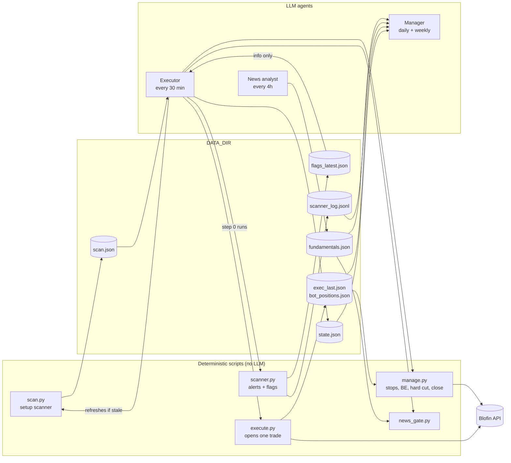

# Architecture

Three agents, five scripts (plus small helper modules), and a handful of shared files. Agents never message each other. They read and write files.

## Pieces

| Piece | Kind | Reads | Writes | Trades? |
|---|---|---|---|---|
| `scripts/scan.py` | script | public market data | `scan.json` | no |
| `scripts/scanner.py` | script (optional) | public market data | `flags_latest.json`, `scanner_state.json`, `scanner_log.jsonl` | no |
| `scripts/execute.py` | script | `scan.json`, account | `exec_last.json`, `bot_positions.json` | yes, at most one per run |
| `scripts/manage.py` | script | account, `bot_positions.json` | `bot_positions.json` | stops, break-even, closes |
| `scripts/news_gate.py` | script | `fundamentals.json` | nothing | no |
| `scripts/universe.py` | helper | config, `fundamentals.json` | nothing | no |
| `scripts/riskcap.py` | helper | positions + TP/SL passed in | nothing | no |
| Executor | agent | all of the above | `state.json` | yes, via `execute.py` and `manage.py` |
| News analyst | agent | `scan.json` universe, the web | `fundamentals.json` | no |
| Manager | agent | every log | reports to the human | no |

## Why it is split this way
- **Scripts do the math.** Scanning, sizing, leverage and filters are deterministic. A script is cheaper, faster and more repeatable than an LLM doing arithmetic.
- **Agents do judgment.** Reading news, deciding whether a stop needs tightening, auditing behavior.
- **Files are the interface.** Any harness can read and write a file. No agent depends on another being awake.
- **One trader.** Only the Executor can place orders. Everyone else is read-only.
- **An auditor that does not trade.** The Manager checks the Executor's work from logs. The Executor never grades itself.

## Safety layers
1. Every order goes through `execute.py` or `manage.py`. The agent never writes order bodies.
2. Both scripts hold `DATA_DIR/execute.lock`, so two order actions never run at once.
3. Every exchange response is checked at the top level and in `data.code`.
4. Config is validated on load (risk 0–10%, hard cut ≥ risk, and more). Bad values stop the run.
5. `execute.py` applies the news gate and macro window to every candidate itself. If an order request times out, it looks the order up by client order id before deciding.
6. `manage.py` only treats a position as the bot's when a record or the order history matches its creation time. Stale records are pruned each run.
7. Use an API key with READ + TRADE only: no transfer, no withdrawal. Bind it to your IP.
